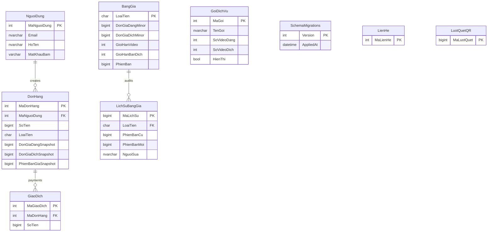

# ERD sơ bộ — các bảng đã đối chiếu code (không phải toàn bộ schema)

Sơ đồ tập trung vào thanh toán và tương tác công khai, chưa rà hết các bảng trong `db/*.sql` hoặc khẳng định đầy đủ ràng buộc FK/PK.

Các bảng `BangGia`, `LichSuBangGia`, `GoiDichVu` là **thiết kế trong migration mới**, chưa xác minh đã thực thi trên CSDL của người dùng. Quan hệ giá → đơn dùng **ảnh chụp giá** theo phiên bản và mã tiền tệ, không khai báo FK cố định để bảo toàn đơn hàng lịch sử.
