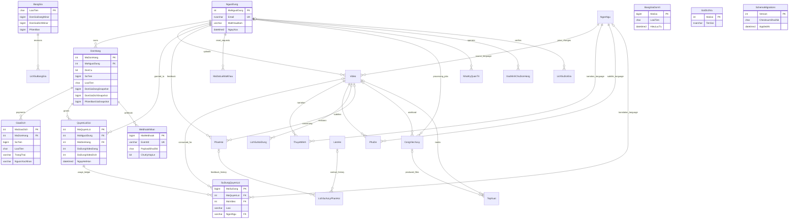

# DubchefDB — sơ đồ quan hệ theo thiết kế migration (chưa nghiệm thu trên SQL Server thực)

Sơ đồ sau được rút từ các file `db/migrations/001...021` và mã nghiệp vụ; xem `db/tests/schema-catalog.sql` để xuất các **FK thật** từ SQL Server trước khi chấm.

**Ghi chú:** Hình Mermaid không thể biểu diễn đầy đủ FK phức hợp `QuyenLoiGoi(MaDonHang,MaNguoiDung)` và `GiaoDich(MaDonHang,LoaiTien,SoTien)`, hay trigger số lượt. Đọc các constraint trong migration 015–016 và kết quả `sys.foreign_key_columns`. Các bảng cấu hình/điều khiển độc lập (`CauHinhHeThong`, `TyGia`, `LanDangNhapSai`, `LuotTruyCap`, `LuotQuetQR`) không cần đường nối vật lý theo thiết kế. `LichSuXuLyPhanHoi` có hai FK tùy chọn và CHECK đúng một.
