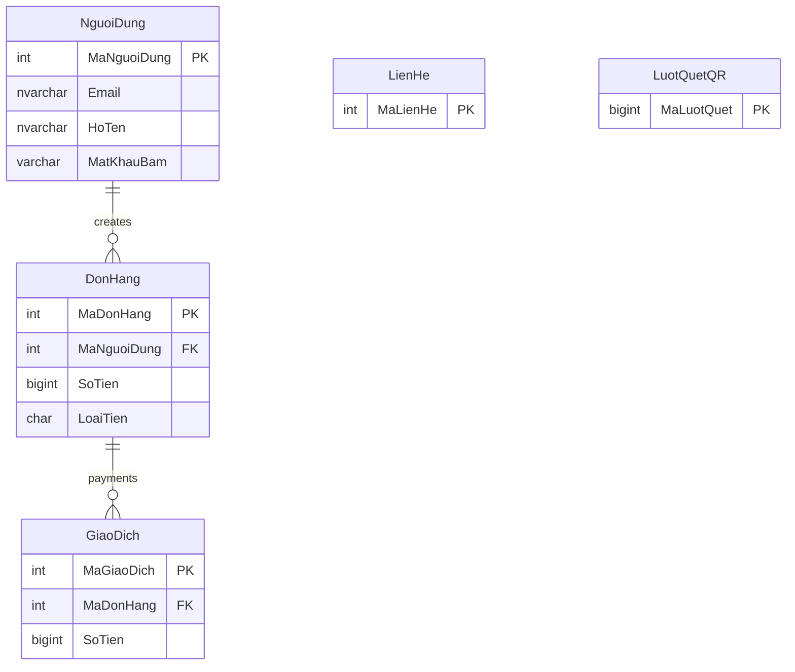

# ERD sơ bộ — các bảng đã đối chiếu code (không phải toàn bộ schema)

Sơ đồ tập trung vào thanh toán và tương tác công khai, chưa rà hết các bảng trong `db/*.sql` hoặc khẳng định đầy đủ ràng buộc FK/PK.
